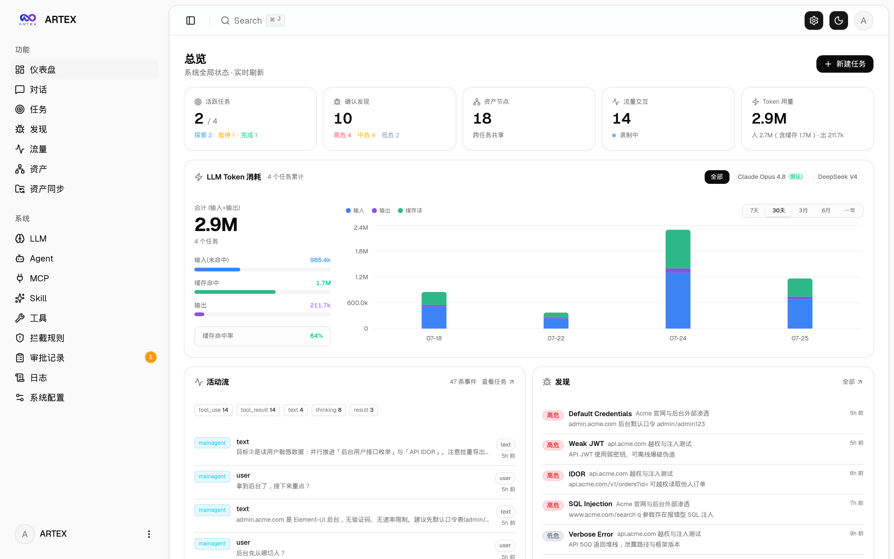
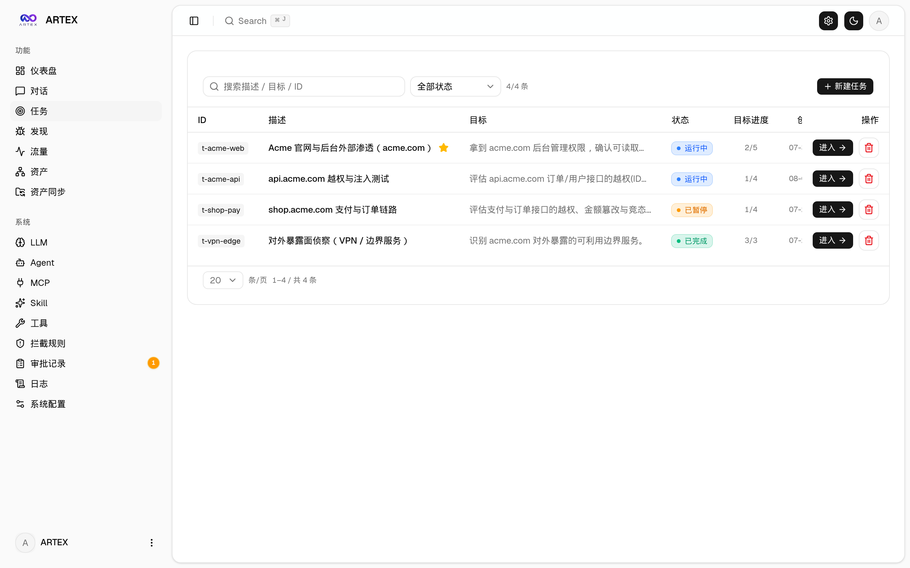
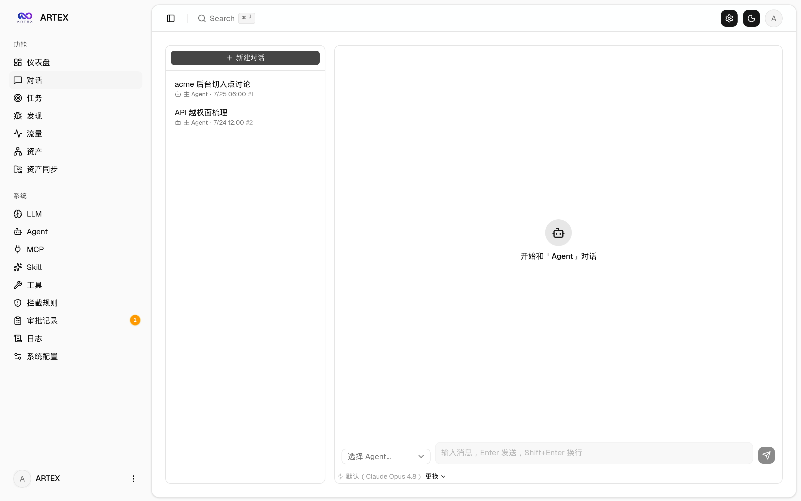
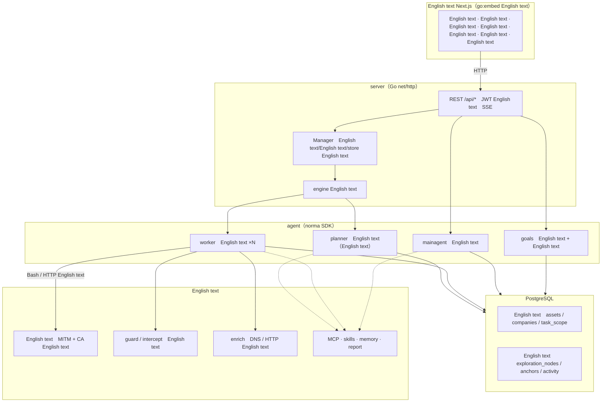
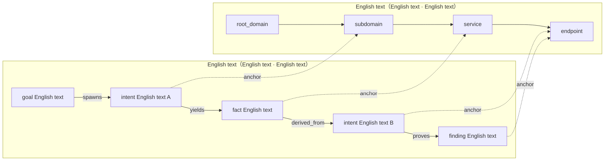
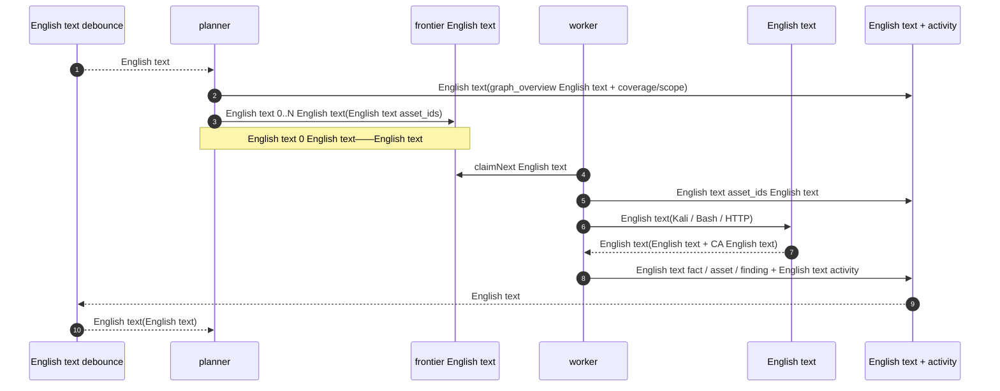
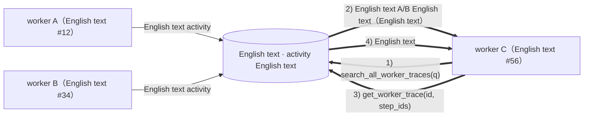
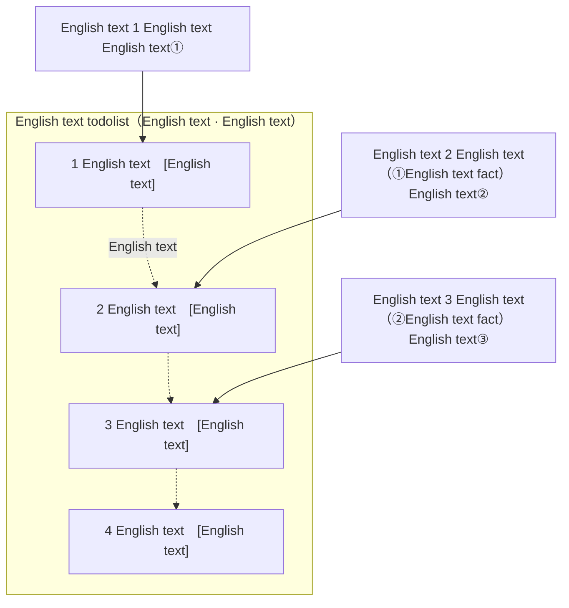

<div align="center">

# ARTEX

AI English text（Go English text + Next.js English text）


🌐 **English text Demo**： [https://artex-demo.vercel.app/](https://artex-demo.vercel.app/)

</div>

---

## English text

> English text[English text Demo](https://artex-demo.vercel.app/)。

| English text（English text / Token English text / English text） | English text |
| :---: | :---: |
|  |  |

| English text · English text（English text / English text） | English text |
| :---: | :---: |
|  |  |

| English text | English text |
| :---: | :---: |
|  |  |

| English text（English text · English text · English text） |
| :---: |
|  |

| English text | English text |
| :---: | :---: |
|  |  |

| Agent English text | LLM English text |
| :---: | :---: |
|  |  |

| English text | English text |
| :---: | :---: |
|  |  |


---

## English text

English text「English text」、English text「English text」English text。English text
[AegisHook English text](https://github.com/RuoJi6/AegisHook/blob/main/web/src/components/CallDetail.vue)，English text ARTEX English text：


## English text（ScopeSentry）

English text [ScopeSentry](https://github.com/Autumn-27/ScopeSentry) English text，English text：

- English text「**English text**」English text ScopeSentry English text API Key，English text；
- English text**English text**English text**English text**English text（English text / English text / IP / English text / English text / English text…）；
- English text，English text ARTEX English text agent English text。

---

## English text

> English text **PostgreSQL**；English text **LLM**（`ANTHROPIC_API_KEY` English text `OPENAI_API_KEY`，English text UI English text）。

### English text：English text（English text）

```bash
git clone https://github.com/Autumn-27/ARTEX.git
cd ARTEX
./install.sh
```

English text：English text / English text Docker → English text **① English text Docker** English text **② English text**：

- **① English text Docker**：English text Postgres English text（English text）→ English text `.env` → `docker compose up -d`。
- **② English text**：English text（English text / English text Docker English text）→ English text `config.json` → `go` English text → English text。

English text **http://localhost:8787**（English text `/setup` English text）。

### English text：Docker Compose（English text）

```bash
git clone https://github.com/Autumn-27/ARTEX.git
cd ARTEX
cp .env.example .env          # English text POSTGRES_PASSWORD、English text ANTHROPIC_API_KEY
docker compose up -d          # English text autumn27/artex English text + postgres
# → http://localhost:8787
```

English text（ripgrep/curl/vim/npm/nmap…）；`./skills` English text `./data` English text。

English text MCP English text `http`（Streamable HTTP）English text `sse`（English text SSE）。
English text SSE English text `GET /sse` English text，English text
`/message?sessionId=...` English text JSON-RPC English text；English text URL English text `/sse`，English text
`Authorization=Bearer <token>` English text。

### English text：English text（Releases）

English text [Releases](https://github.com/Autumn-27/ARTEX/releases) English text zip，English text `artex` + `start.sh`（Windows English text `start.bat`）+ `skills/` + `config.example.json`：

```bash
cp config.example.json config.json   # English text database English text
./start.sh                           # → http://localhost:8787
```

> English text `start.sh` / `start.bat` English text，English text `./artex`。English text：English text，**English text[English text](#English text)English text**。English text `./artex` English text。
> English text：`nohup ./start.sh >artex.log 2>&1 &`。

### English text：English text

```bash
# 1) English text
cd web && npm ci && npm run build:static && cd ..
# 2) English text
cp -r web/out server/webui/dist
# 3) English text（-tags embedui English text）
CGO_ENABLED=0 go build -tags embedui -o artex ./cmd/artex
./start.sh
```

### English text：English text Release English text

`build.sh` English text，English text Go linker English text，English text zip。Release English text Linux amd64/arm64、macOS amd64/arm64 English text Windows amd64 English text zip English text：

```bash
./build.sh --release
# English text：dist/artex-0.3.3-*.zip
```

UPX English text Linux English text、English text，English text。English text `ARTEX_TARGETS` English text；English text，English text `--upx` English text：

```bash
ARTEX_TARGETS=linux/amd64,windows/amd64 ./build.sh --release
./build.sh --target linux/amd64 --upx
```

---

## English text

> English text、English text：Postgres English text `pgdata`、`./data`（jwt.key / SQLite English text）、`./skills` English text。**English text**——`artex` English text `schema.sql`（English text `ADD COLUMN` / `CREATE INDEX IF NOT EXISTS`），English text“English text”。English text `./data` English text。

### English text：English text（English text）

English text **English text** English text（English text「English text」→ `/system/settings`）English text**English text**English text，English text，English text。

English text「English text」English text：English text → English text Release English text `SHA256SUMS` → English text `-h` English text → English text `artex.new` → English text，English text `start.sh` / `start.bat` English text。English text。

- **English text**：English text、English text；English text 3 English text，English text `artex.old`（English text `artex.failed` English text）。
- **English text**：English text `artex.old`，English text「English text」。English text。
- **English text**——English text，English text。
- **English text**：English text `dev` English text `git describe` English text，English text。
- **Docker English text、English text**：English text playwright / nmap English text，English text `docker compose up -d` English text。English text `docker compose pull artex && docker compose up -d artex`。
- English text GitHub English text，English text**English text**English text，English text。English text GitHub English text HTTPS。

### English text：English text

```bash
cd ARTEX
./update.sh
```

English text `git pull` English text，English text **① Docker English text** English text **② English text**（English text `install.sh` English text）：

- **① Docker**：English text tag（English text `.env` English text `ARTEX_TAG`，English text `latest`）→ `docker compose pull` → `docker compose up -d`（English text）。
- **② English text**：English text → English text `./artex`（English text）。

### English text：Docker Compose（English text）

```bash
cd ARTEX
git pull                       # English text compose / English text（English text）
# English text：English text .env English text ARTEX_TAG=v0.2.0；English text latest
docker compose pull artex
docker compose up -d artex     # English text → English text schema
docker image prune -f          # English text（English text）
```

### English text：English text（Releases）

English text [Releases](https://github.com/Autumn-27/ARTEX/releases) English text zip，English text `artex` English text `skills/`（English text `config.json` English text `data/`），English text：

```bash
cp -r <English text>/skills ./ && cp <English text>/artex ./
./start.sh
```

### English text：English text

```bash
git pull
cd web && npm ci && npm run build:static && cd ..
cp -r web/out server/webui/dist
CGO_ENABLED=0 go build -tags embedui -o artex ./cmd/artex
# English text ./start.sh
```

---

## English text

**English text**（`config.json`，English text `ARTEX_PG_DSN` English text）：

```json
{
  "database": {
    "host": "127.0.0.1", "port": 5432,
    "user": "artex", "password": "yourpass",
    "dbname": "artex", "sslmode": "disable"
  }
}
```

**LLM**：`export ANTHROPIC_API_KEY=sk-...`（English text `OPENAI_API_KEY`），English text UI English text「LLM English text」English text。
English text：`ARTEX_LLM_PROVIDER` / `ARTEX_LLM_MODEL` / `ARTEX_LLM_BASE_URL` / `ARTEX_LLM_PROXY`。

**English text**：English text work agent English text「English text」English text（English text 3）。

**English text**：`./start.sh -addr :8787 -proxy :8788`（`-addr` English text+API，`-proxy` English text）。English text `artex`。

### English text（HTTPS / English text 443）

English text API/SSE English text（English text `:8787`）English text，English text**English text**English text，English text**English text `NEXT_PUBLIC_SSE_BASE`**，English text 443、English text 8787 English text。

SSE English text + English text，English text**English text**，English text（English text）。Nginx English text：

```nginx
server {
    listen 443 ssl;
    server_name your.domain.com;
    # ssl_certificate / ssl_certificate_key ...

    location / {
        proxy_pass http://127.0.0.1:8787;
        proxy_set_header Host $host;
        proxy_set_header X-Forwarded-Proto $scheme;

        # SSE English text：English text、English text、HTTP/1.1
        proxy_buffering off;
        proxy_cache off;
        proxy_read_timeout 3600s;
        proxy_http_version 1.1;
        proxy_set_header Connection "";
    }
}
```

> English text SSE English text（English text）English text，English text**English text**English text `NEXT_PUBLIC_SSE_BASE`（English text `next build` English text，English text）。

---


## English text

### English text

English text「English text」English text、English text，English text。English text，English text「English text」；English text。

English text「English text」，English text「English text」English text「English text」，English text、English text，English text Agent English text，English text。English text、English text；English text「English text」，English text，English text「English text」。English text，English text「English text」「English text」「English text」，English text、English text。

English text「English text」（`retester`）Agent，English text Agent English text、LLM、English text。English text LLM，English text。English text「English text」English text，English text「English text」；English text、English text、English text。English text。English text「English text」。English text，English text、English text。

English text，English text，English text。English text，English text。

### English text

```bash
./dev.sh    # English text(:8787) + English text(:8788) + English text next dev(:5173) → http://localhost:5173
```

- English text：`go run ./cmd/artex`（English text `-tags embedui` English text）
- English text：`cd web && npm run dev`（`/api` English text，English text）
- English text：`go test ./...`
- Mock English text（English text）：`cd web && NEXT_PUBLIC_MOCK=1 npm run dev`

---

## English text

ARTEX English text **LLM English text agent English text**：Go English text（English text Next.js English text）+ PostgreSQL，agent English text [`norma`](https://github.com/Autumn-27/norma) SDK English text（`agentcore` / `tool` / `permission` / `harness` / `memory` / `transcript`）。English text**English text**，English text：**worker English text**English text **planner English text todolist English text**。

### English text



| English text | English text |
| --- | --- |
| **English text** | Next.js English text，`go:embed` English text；English text/English text/English text/English text，English text |
| **server** | `net/http` English text + JWT English text + SSE；`Manager` English text、English text、DB store English text |
| **engine** | English text `plannerLoop` + N English text worker goroutine；English text、English text/English text/drain |
| **agent** | goals / planner / worker / mainagent，`ToolSet` English text LLM English text |
| **db** | English text Postgres English text（pgx）；schema English text `go:embed` English text |
| **English text** | English text MITM English text、English text、English text、MCP/English text/English text/English text |

### English text：English text + English text

English text「**English text**」English text「**English text**」English text、English text：

- **English text（Asset Graph，English text）**：English text。English text `root_domain / subdomain / ip / service / app / endpoint`，English text；English text→English text→English text→English text key English text，agent English text。
- **English text（Exploration Graph，English text）**：English text“English text”English text。English text `goal（English text）/ intent（English text）/ fact（English text）/ finding（English text）/ hint（English text）`，English text `spawns / derived_from / yields / proves` English text**English text**，English text“English text、English text”。
- **English text**：`exploration_anchors(node_id, asset_id)` English text/English text/English text——English text“English text”English text，English text“English text”English text、English text。English text**English text**English text**English text**（English text + English text）。



> English text：**planner** English text、English text、English text**English text**English text frontier；**worker** English text**English text**、English text、English text/English text/English text。English text，English text。

### English text（English text）

English text**English text**English text：English text planner，planner English text，worker English text，English text——English text（`prove_goal`）。



### worker English text

English text，English text（English text、English text、English text）English text worker English text**English text**English text，English text fact。English text、English text worker English text，worker English text**English text work English text**English text：

- `search_all_worker_traces(q)`：English text**English text work English text**English text（English text），English text `intent_id`；
- `list_worker_traces` / `get_worker_trace(intent_id, step_ids=[…])`：English text work English text，English text work English text。

English text fact，English text worker English text——**English text worker English text“English text”English text**，English text（English text worker English text）。



### planner English text todolist → English text

English text**English text**（English text：English text → English text → English text → English text），English text。planner English text**English text、English text（todolist）**：

- planner English text——English text，English text**English text**；English text todolist English text**English text**、English text**English text**，English text；
- English text「English text、English text fact English text」English text，English text（English text fact English text）。



English text“English text + English text”English text**English text、English text、English text**——English text ARTEX English text。

---

## English text

English text **SecSentry**，English text。

<div align="center">


</div>

---
## English text

https://github.com/oritera/Cairn


## English text

### English text

English text **GNU Affero General Public License v3.0（AGPL-3.0）** English text，English text [LICENSE](LICENSE) English text。

English text、English text，English text**English text AGPL-3.0 English text**；English text，**English text（English text）English text，English text**。

> ⚠️ **English text**：English text。English text「English text」English text「English text」English text，English text。

**ARTEX English text、English text，English text。**

### English text

- English text**English text、English text**，English text**English text**English text；
- English text、English text、English text。

### English text

- **English text、English text、English text、English text**（English text、English text）；
- English text、English text；
- English text、English text、English text、English text、English text；
- English text/English text。

### English text

English text/English text、English text（English text《English text》《English text》《English text》English text）。**English text，English text。**

### English text

English text“English text（AS IS）”English text，English text。English text（English text）English text、English text、English text。**English text、English text，English text、English text。**
