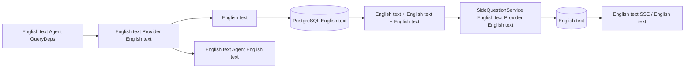

# ARTEX `/btw`

English text、English text MainAgent English text Worker English text。English text `/btw English text` English text，English text `/btw` English text“English text”English text。English text，English text Drawer。

English text Agent English text，English text、English text、English text。English text、English text SSE English text。English text；English text，English text。

## English text

English text Go、norma v0.3.7、Next.js、English text Markdown / ResizablePanel / Drawer / AlertDialog English text；English text norma English text。Planner、English text Worker、English text。

- `capture.go` English text `Options.Deps.CallModel / CallModelSync` English text。Provider English text、English text，English text；English text。
- English text、English text、English text。English text；English text norma English text `MessagesForAPI` English text，English text。English text。
- English text JSON English text、English text、English text。English text。
- `SideQuestionService` English text Provider；English text，English text/English text。English text agent session，English text、English text transcript、English text，English text。English text；English text。English text。
- English text，English text，English text 120 English text。English text。
- English text；English text。English text，English text、English text、English text，English text Agent English text。English text。

## English text

`db/schema.sql` English text `side_question_sessions` English text `side_question_requests`。English text、English text、English text、English text；English text、English text、English text、English text、English text、English text、English text。

English text conversation ID，English text task ID + exploration ID + intent ID。Worker English text。

English text，English text 250 ms English text，English text `(run_id, version)` English text。English text。English text；English text。English text 250 ms English text，English text。

English text `running` English text `interrupted`，English text，English text。English text。English text Agent，English text UI English text。

English text；English text。English text，Worker English text，English text。English text、English text、English text；English text v3，English text v1/v2。

English text，English text 20 English text。English text 20 English text，English text token English text；English text。English text，English text。English text、English text、English text 120 English text。English text [English text](CONTEXT_BUDGET.md)。

## HTTP English text

English text `{parent}`，English text：

- `/api/conversations/{id}`
- `/api/tasks/{id}/chat`
- `/api/tasks/{id}/intents/{iid}`

| English text | English text |
| --- | --- |
| `GET {parent}/side-questions?before={ordinal}` | `items` English text、English text `current` English text、`snapshot` English text、`next_cursor`；English text 0 English text / English text |
| `POST {parent}/side-questions` | JSON `{ "question": "…", "client_request_id": "UUID" }`；English text 202 English text；English text ID English text 200 |
| `DELETE {parent}/side-questions` | English text |
| `GET /api/side-questions/{requestID}/events` | `snapshot` SSE English text，`id` English text，`data` English text；English text `cleared` |
| `POST /api/side-questions/{requestID}/cancel` | English text；English text SSE English text |

English text 4000 English text。English text、English text、English text ID English text 409；English text 429。English text SSE English text，English text。English text ID + English text，English text、English text。

## English text

English text、English text [VALIDATION.md](VALIDATION.md)。

English text [Grok CLI side-question.ts（English text）](https://github.com/superagent-ai/grok-cli/blob/fb97af83f06dca873281d60168430f06c8de6324/src/utils/side-question.ts)，English text [OpenCode（English text）](https://github.com/anomalyco/opencode/tree/b3f1a96c6dd7adeb28b36dd11add1998fc84d67b)。ARTEX English text norma English text，English text。
