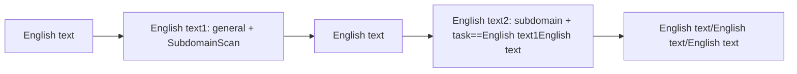

---

## name: scopesentry-mcp
description: English text ScopeSentry MCP English text（English text、English text、English text、English text、English text）。English text ScopeSentry、MCP、API Key、English text、English text。

# ScopeSentry MCP English text

English text**English text ScopeSentry English text**English text。English text Cursor（English text MCP English text）English text，English text。

## 1. English text

### 1.1 English text

- English text Web English text：`http://<English text>`
- MCP English text：`http://<English text>/mcp`（English text，English text `/mcp` English text）

### 1.2 English text API Key

1. English text ScopeSentry Web English text
2. English text **API Key** English text（English text）
3. English text `ssk_...` English text（**English text**）

### 1.3 English text Cursor MCP

Cursor → Settings → MCP → English text：

```json
{
  "mcpServers": {
    "scopesentry": {
      "url": "http://<English text>:8082/mcp",
      "headers": {
        "X-API-Key": "ssk_English text"
      }
    }
  }
}
```

English text：`Authorization: Bearer ssk_English text`

English text MCP English text Cursor，English text `list_projects`、`list_assets` English text。

---

## 2. English text


| English text                     | English text                |
| ---------------------- | ----------------- |
| `list_projects`        | English text（English text ID） |
| `list_projects_data`   | English text，English text     |
| `get_project`          | English text              |
| `create_project`       | English text              |
| `list_tasks`           | English text            |
| `get_task`             | English text              |
| `list_scan_templates`  | English text            |
| `get_scan_template`    | English text              |
| `list_plugin_modules`  | English text          |
| `list_plugins`         | English text（English text hash、English text） |
| `create_scan_template` | English text            |
| `create_scan_task`     | English text            |
| `list_assets`          | English text（English text）       |
| `count_assets`         | English text（`/api/assets/common/total`） |
| `get_asset_detail`     | English text           |
| `add_asset_tag`        | English text           |
| `list_nodes`           | English text            |


English text MCP English text（schema）English text；`list_assets` / `count_assets` English text search、filter English text，English text `list_assets` description。

English text「English text」English text `count_assets`（English text Web English text），English text `list_assets`。

---

## 3. English text

### 3.1 English text

English text**English text**English text，English text `filter.project` English text，English text。English text，English text。

1. `list_projects` English text `list_projects_data` English text **ObjectID**（`id` / `children[].value`）
2. `list_assets` English text `filter.project`（**English text ID，English text**）

```json
{
  "asset_type": "asset",
  "pageIndex": 1,
  "pageSize": 20,
  "search": "domain=^example.com",
  "filter": {
    "project": ["<English textObjectID>"]
  }
}
```

### 3.2 English text

1. `list_nodes` English text
2. `list_scan_templates` English text `create_scan_template` English text **ObjectID**
3. `create_scan_task`：`name`、`node` English text，`template` English text ID（English text）

**English text `targetSource`（English text Web English text）：**

| targetSource | English text | English text |
| --- | --- | --- |
| `general` | English text | `target` |
| `project` | English text | `project`（English text ObjectID English text） |
| `asset` | English text Web English text | `search`；English text `project`、`filter`、`targetNumber` |
| `RootDomain` | English text | `search`；English text `project`、`filter`、`targetNumber` |
| `subdomain` | English text | `search`；English text `project`、`filter`、`targetNumber` |
| `UrlScan` | English text URL English text | `search`；English text `project`、`filter`、`targetNumber` |
| `*Source`（English text `subdomainSource`） | English text「English text/English text」English text | `targetTp=search` English text `search`；`targetTp=select` English text `targetIds` |

**English text — English text：**

```json
{
  "name": "example-English text",
  "node": ["node-1"],
  "template": "<English textObjectID>",
  "targetSource": "general",
  "target": "example.com\nfoo.com",
  "project": ["<English textObjectID>"]
}
```

**English text — English text（English text）：**

```json
{
  "name": "example-English text",
  "node": ["node-1"],
  "template": "<English textObjectID>",
  "targetSource": "subdomain",
  "search": "task==\"example-English text\"",
  "project": ["<English textObjectID>"]
}
```

### 3.3 English text（English text）

English text**English text**English text**English text**English text，English text，English text。

**English text：** English text**English text**English text。English text，English text，English text，English text、English text、English text。

**English text：**

1. **English text — English text**
   - `targetSource`: `general`
   - `target`: English text（English text）
   - English text：English text `SubdomainScan`、`SubdomainSecurity`（English text + English text）
   - English text `get_task` English text

2. **English text — English text**
   - `targetSource`: `subdomain`
   - `search`: `task=="<English text>"`（English text）
   - English text `project` English text
   - English text：English text、English text、English text（English text SubdomainScan）
   - English text，English text

English text Web English text「English text」English text，English text「English text」，English text。



### 3.4 English text

1. `list_plugin_modules` → English text
2. `list_plugins`（English text `module` English text）→ English text `hash` English text `parameter`
3. `create_scan_template`：English text `modules` English text「English text → English text hash English text」

---

## 4. English text（`list_assets` / `count_assets`）

`count_assets` English text `list_assets` English text `asset_type`、`search`、`filter`，English text `{ "total": N }`，English text Web English text `/api/assets/common/total`。

```json
{
  "asset_type": "subdomain",
  "search": "task==\"English text\"",
  "filter": {"project": ["<English textObjectID>"]}
}
```

**English text（`list_assets` / `count_assets` English text）：** English text `filter.project` English text；`search` English text `==` English text `^` English text（English text [4.3](#43-search-English text)），English text `=` English text。English text。

English text `filter.project` English text [4.4](#44-filter-English text) English text。

### 4.1 English text `asset_type`

`asset`、`RootDomain`、`subdomain`、`app`、`mp`、`UrlScan`、`SensitiveResult`、`DirScanResult`、`crawler`、`vulnerability`、`PageMonitoring`、`IPAsset`、`SubdomainTakerResult`

English text：`web`→asset、`vuln`→vulnerability、`ip`→IPAsset、`url`→UrlScan

### 4.2 English text


| English text                       | English text                                      |
| ------------------------ | --------------------------------------- |
| `pageIndex` / `pageSize` | English text，English text 1 / 20                            |
| `search`                 | English text（English text）                              |
| `filter`                 | English text JSON（English text）                          |
| `sort`                   | English text UrlScan、DirScanResult English text `length` English text |
| `sid`                    | English text SensitiveResult：English text                |


`search` English text `filter` **English text**。

### 4.3 search English text

English text DSL（**English text SQL**）：


| English text  | English text   | English text | English text                          |
| ---- | ---- | ---- | --------------------------- |
| `=`  | English text（regex） | English text | `domain=example`            |
| `==` | English text（English text） | **English text** | `port==443`                 |
| `!=` | English text   | — | `port!="80"`                |
| `&&` | English text    | — | `domain==example.com && port==443` |
| `||` | English text    | — | `title=admin || body=login` |


**English text：** `domain`、`ip`、`port`、`title` English text，English text **`==` English text** English text **English text `^` English text**（English text `domain=^example.com`）English text；**`=` English text regex English text，English text**，English text。

**English text search English text：** `tag`、`task`（English text）、`rootDomain`

**project English text search English text**（English text `&&` English text）。English text `filter.project`。

**English text search English text：**


| asset_type           | English text                                                                                  |
| -------------------- | ----------------------------------------------------------------------------------- |
| asset                | domain, ip, port, service, app, title, statuscode, icon, banner, type, body, header |
| RootDomain           | domain, icp, company                                                                |
| subdomain            | domain, ip, type, value                                                             |
| app                  | name, icp, company, category, description, url, apk                                 |
| mp                   | name, icp, company, category, description, url                                      |
| UrlScan              | url, input, source, resultId, type                                                  |
| SensitiveResult      | url, sname, body, info, md5                                                         |
| DirScanResult        | url, statuscode, redirect, length                                                   |
| vulnerability        | url, vulname, matched, request, response, level                                     |
| crawler              | url, method, body, resultId                                                         |
| PageMonitoring       | url, hash, diff, response                                                           |
| IPAsset              | ip, domain, port, service, webServer, app                                           |
| SubdomainTakerResult | domain, value, type, response                                                       |


**search English text：**

- `domain==www.example.com && port==443`（English text，English text）
- `domain=^example.com`（English text，English text）
- `ip==192.168.1.1`
- `task=="English text"`
- `level==high`（vulnerability）
- `statuscode==200`（DirScanResult）

English text `=`，English text `title=admin`（English text，English text）。

### 4.4 filter English text

JSON English text：English text key English text **OR**，English text key English text **AND**。

**English text `project`：** English text，English text asset_type English text `project`，English text；English text。


| filter key   | English text       | English text                                                     |
| ------------ | -------- | -------------------------------------------------------- |
| `project`    | English text     | **ObjectID**，English text `list_projects` / `list_projects_data` English text |
| `task`       | English text     | **English text**，English text `list_tasks` English text `name`                         |
| `port`       | English text       | English text `"443"`                                                |
| `service`    | English text/English text    | English text `"https"`                                              |
| `app`        | English text     | English text `"Nginx"`                                              |
| `icon`       | English text hash  |                                                          |
| `statuscode` | HTTP English text | English text asset                                               |
| `status`     | English text       | UrlScan/DirScan HTTP English text；English text/English text                       |
| `level`      | English text     | critical / high / medium / low / info                    |
| `type`       | English text       | English text A、CNAME                                         |
| `color`      | English text   | SensitiveResult                                          |
| `sname`      | English text    | SensitiveResult                                          |
| `tags`       | English text       |                                                          |


**English text filter key：**


| asset_type                            | filter key                                                      |
| ------------------------------------- | --------------------------------------------------------------- |
| asset                                 | project, port, service, app, icon, statuscode, type, task, tags |
| RootDomain                            | project, tags                                                   |
| subdomain                             | project, type, task, tags                                       |
| app / mp                              | project, tags                                                   |
| UrlScan                               | status, tags                                                    |
| DirScanResult                         | status, tags                                                    |
| SensitiveResult                       | status, color, sname, tags                                      |
| crawler                               | project, task, tags                                             |
| vulnerability                         | project, level, status, task, tags                              |
| PageMonitoring / SubdomainTakerResult | tags                                                            |
| IPAsset                               | project, port, service, app                                     |


**filter English text：**

```json
{"project": ["<English textObjectID>"], "port": ["443"]}
```

**English text：**

```json
{
  "asset_type": "asset",
  "search": "domain=^baidu && port==443",
  "filter": {"project": ["<English textObjectID>"]},
  "pageIndex": 1,
  "pageSize": 10
}
```

**English text：**

- English text `filter.project`（English text）；English text
- `filter.project` English text
- English text `==`，English text `^`；English text `=` English text
- UrlScan English text HTTP English text `filter.status`；DirScanResult English text search English text `statuscode==200`
- SensitiveResult English text：`search` English text `sname=English text`，English text `filter.sname`

### 4.5 English text sort

English text **UrlScan**、**DirScanResult** English text：

```json
{"length": "ascending"}
```

English text `sort`，English text。

---

## 5. English text

`TargetHandler`、`SubdomainScan`、`SubdomainSecurity`、`PortScanPreparation`、`PortScan`、`PortFingerprint`、`AssetMapping`、`AssetHandle`、`URLScan`、`WebCrawler`、`URLSecurity`、`DirScan`、`VulnerabilityScan`、`PassiveScan`

---

## 6. English text


| English text        | English text                                                 |
| --------- | -------------------------------------------------- |
| MCP English text   | English text URL、API Key、ScopeSentry English text                    |
| 401 / 403 | English text API Key                                    |
| English text     | English text `filter.project` English text ObjectID；English text search English text project |
| English text/English text | `template` English text ObjectID；`node` English text            |
| English text/English text   | English text `filter.project`；search English text `==` English text `^` English text，English text `=`；English text `pageSize` |


---

